# Smart Resume Analyzer — Editorial AI Career Studio 🚀

[](https://fastapi.tiangolo.com)
[](https://react.dev/)
[](https://vitejs.dev/)
[](https://tailwindcss.com/)
[](https://ai.google.dev/)
[](https://opensource.org/licenses/MIT)

An intelligent, full-stack career acceleration platform combining **ATS Resume Diagnostic Scoring**, **Google Gemini Executive Bullet Point Rewrites (XYZ formula)**, **Voice-powered AI Mock Interviews with Web Speech & Gemini audio fallback**, and **Daily Practice Streaks with 90-day activity heatmaps**.

Built with an editorial **"Ink and Sunset"** design system featuring dedicated feature accents, responsive mobile navigation, fluid typography (`clamp()`), and zero-friction standalone operation with **only a Gemini API key**.

---

## 📸 Screenshots

### Desktop View (1440 × 900)

| View | Dark Mode ("Warm Ink" `#0F0E13`) | Light Mode ("Cream" `#FAF6EF`) |
| :--- | :--- | :--- |
| **Landing Page** | 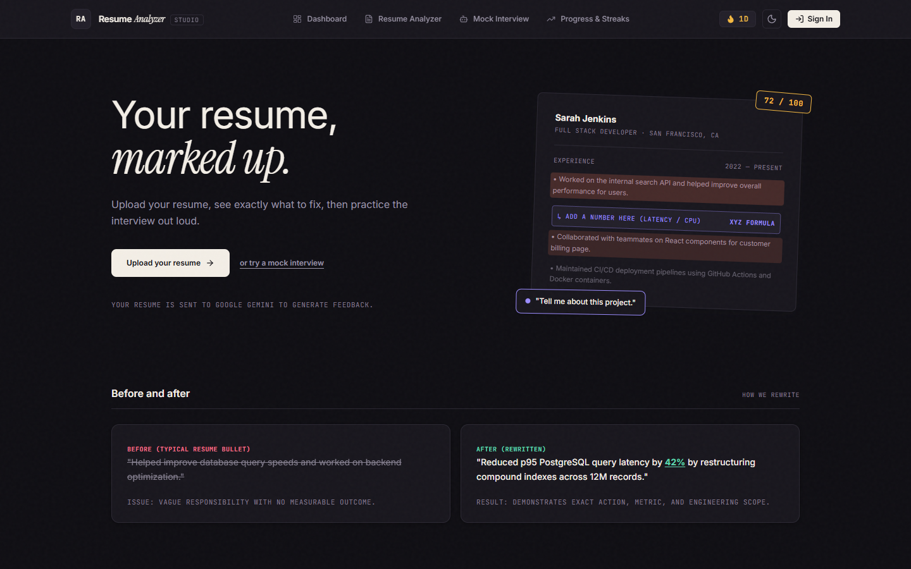 | 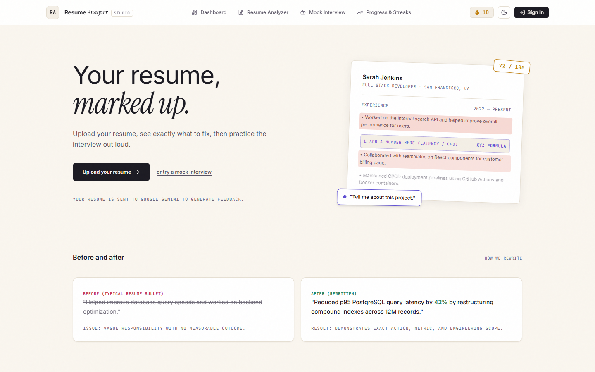 |
| **Dashboard** | 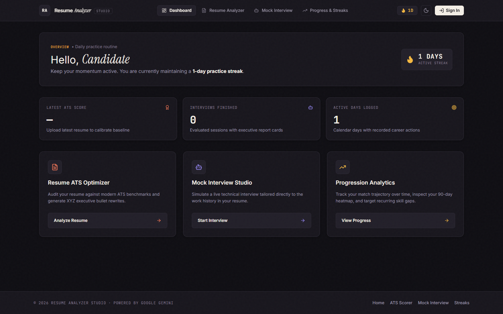 | 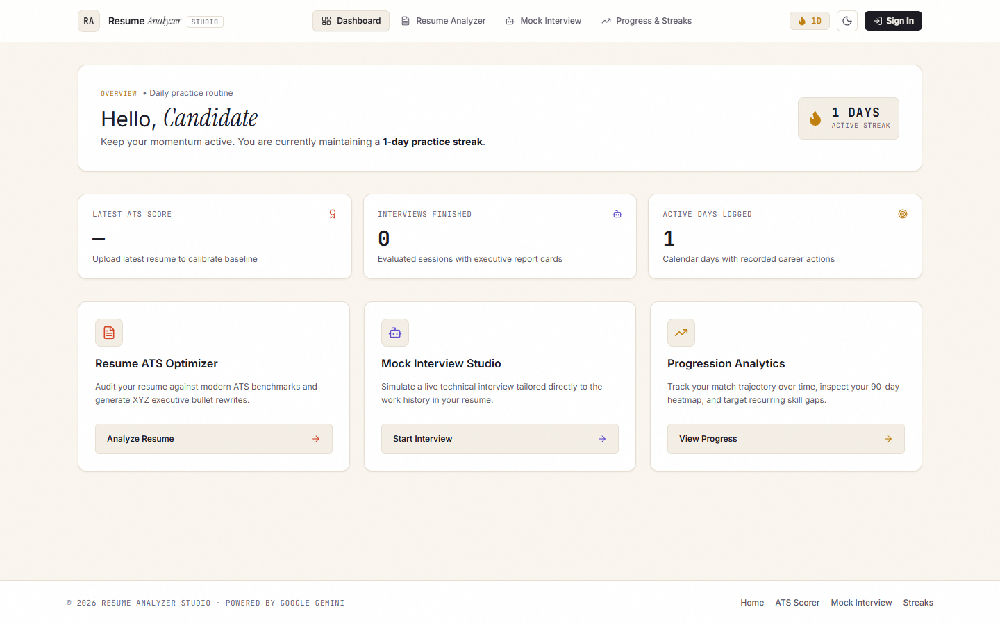 |
| **Resume Analyzer** *(Coral Accent)* | 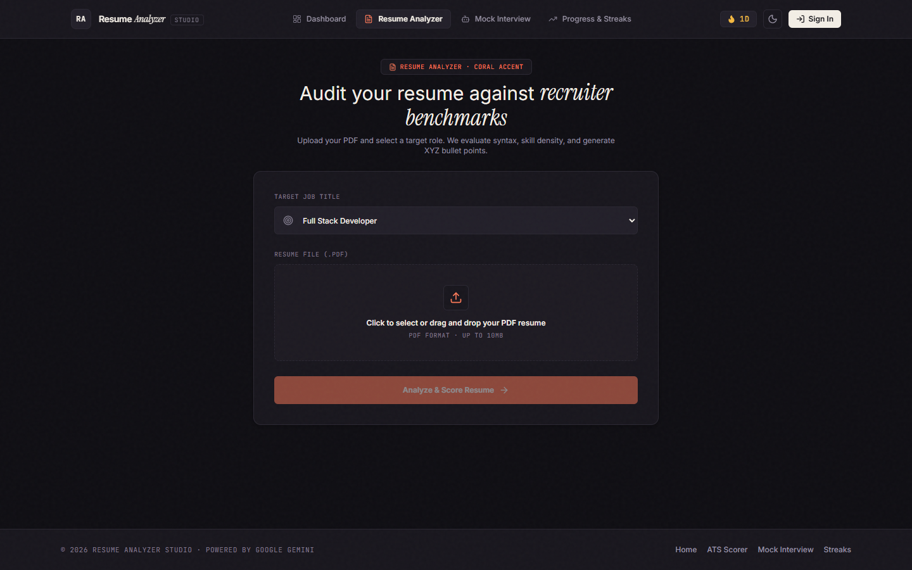 | 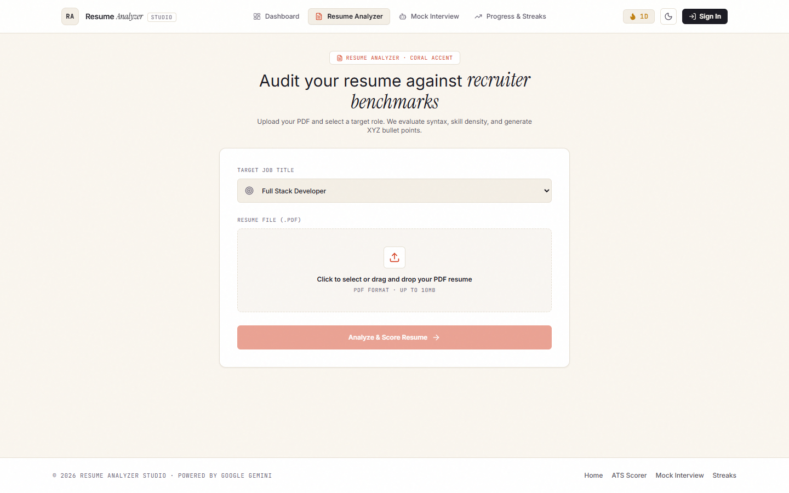 |
| **Mock Interview** *(Lavender Accent)* | 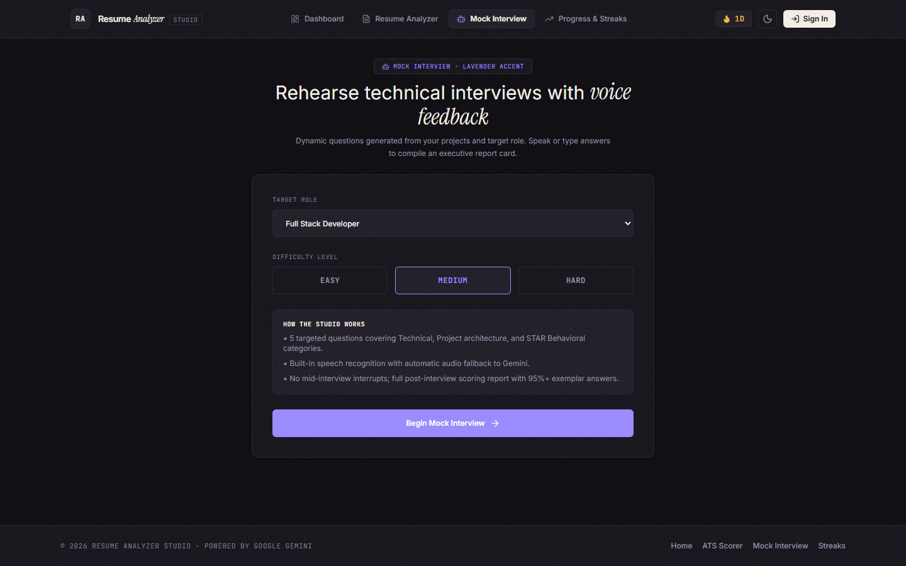 | 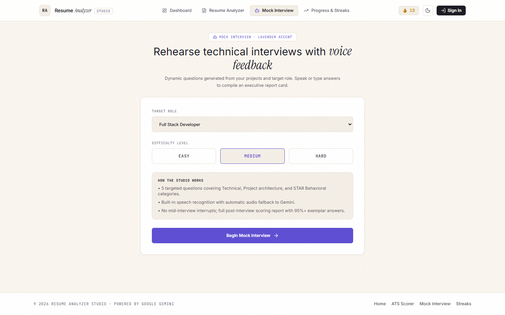 |
| **Progress & Streaks** *(Amber Accent)* | 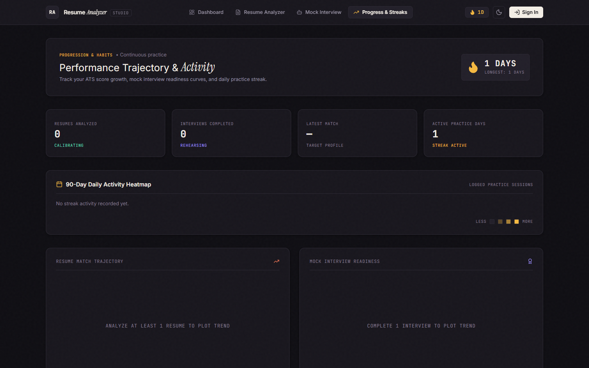 | 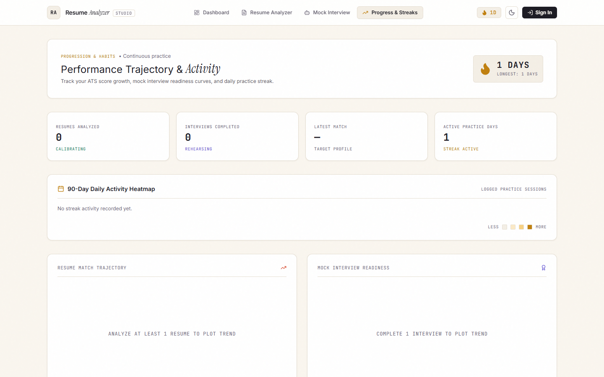 |

### Mobile View (390 × 844)

| Feature | Dark Mode | Light Mode |
| :--- | :--- | :--- |
| **Landing Hero** | 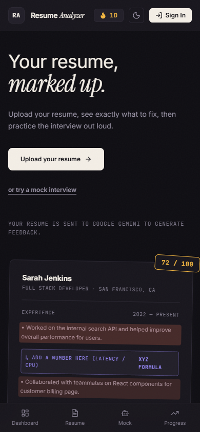 | 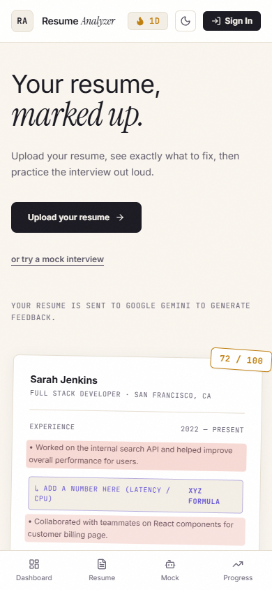 |
| **Mobile Dashboard** | 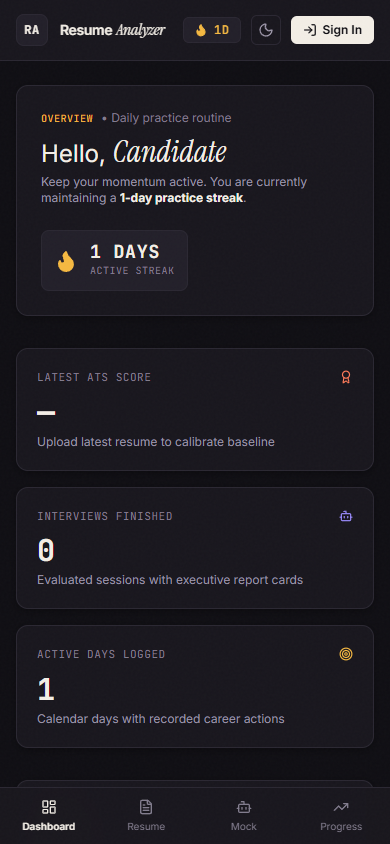 | 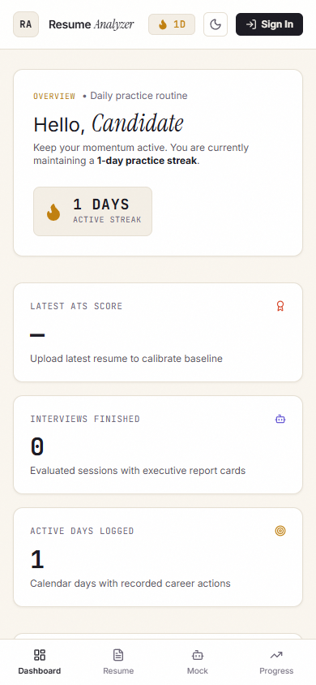 |
| **Mobile Analyzer** | 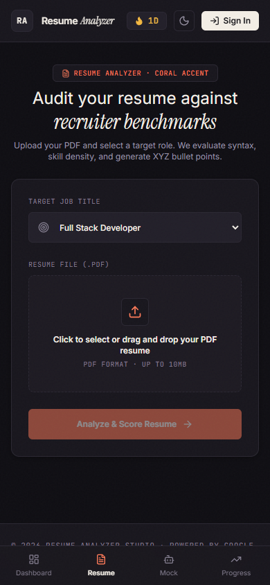 | 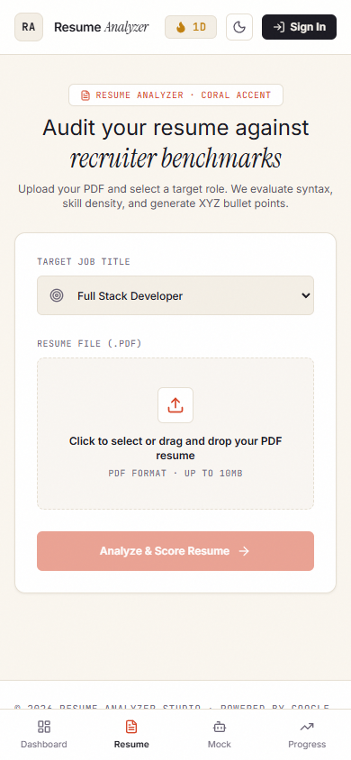 |
| **Mobile Interview** | 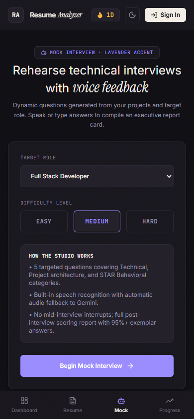 | 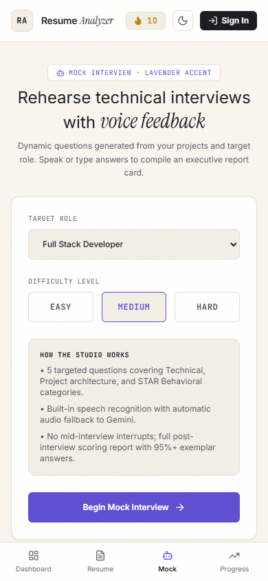 |
| **Mobile Progress & Heatmap** | 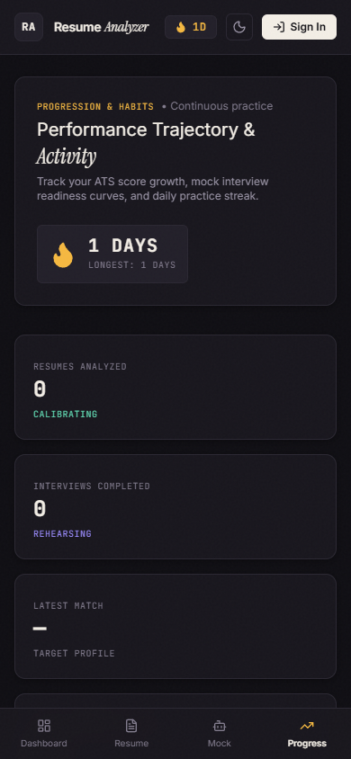 | 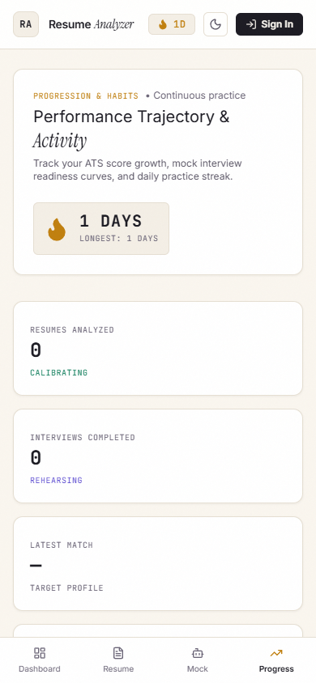 |

---

## 🌟 Architecture & Capabilities

```
┌─────────────────────────────────────────────────────────────────────────────┐
│                 SMART RESUME ANALYZER · INK & SUNSET                        │
├───────────────────────────────┬─────────────────────────────────────────────┤
│  🎯 1. Resume ATS Diagnostic  │  🎙️ 2. AI Mock Interview Simulator          │
│  • Coral Accent (#FF7A59)     │  • Lavender Accent (#9B8CFF)                │
│  • Multi-factor match gauge   │  • Tailored technical & behavioral questions│
│  • Google XYZ formula rewrites│  • Web Speech API + Gemini audio fallback   │
│  • Real-time missing keywords │  • Post-interview report & exemplar answers │
├───────────────────────────────┼─────────────────────────────────────────────┤
│  🔥 3. Daily Practice Streaks │  📈 4. Multi-Attempt Progression Curves     │
│  • Amber Accent (#F5B841)     │  • Recharts score progression over time     │
│  • 4-tier 90-day activity map │  • Recurring weakness diagnostics           │
│  • Mobile bottom tab bar      │  • Fully functional with Gemini key alone   │
└───────────────────────────────┴─────────────────────────────────────────────┘
```

### 1. Robust AI Provider Abstraction (`backend/services/ai_provider.py`)
- **Works 100% with only `GEMINI_API_KEY`**: Groq is completely optional.
- **Configurable Models**:
  - `GEMINI_MODEL` (default: `gemini-2.5-flash`): Powers deep ATS resume analysis and post-interview report compilation.
  - `GEMINI_FAST_MODEL` (default: `gemini-2.5-flash-lite`): Powers fast, live question generation and low-latency interaction.
- **Automatic Retries & Exponential Backoff**: Gracefully handles rate limits and 5xx errors.
- **Optional Secondary Fallback**: Automatically tries OpenRouter or Groq **only if** their keys are specified in `.env`.
- **Direct Audio Transcription Fallback**: If the browser does not support the Web Speech API (Firefox, iOS Safari), audio is recorded via `MediaRecorder` and transcribed directly using Gemini's native audio input via `/api/interview/transcribe`.

### 2. "Ink and Sunset" Editorial Design System
- **Dark Mode**: Warm ink background (`#0F0E13`), surface (`#18161D`), border (`#2A2732`), text (`#F3EEE6`), muted (`#9A94A6`).
- **Light Mode**: Warm cream background (`#FAF6EF`), surface (`#FFFFFF`), border (`#E6DFD2`), text (`#1B1A22`), muted (`#6B6577`).
- **Feature Accents**:
  - **Resume Analyzer**: Coral (`#FF7A59` dark / `#E8573A` light)
  - **Mock Interview**: Lavender (`#9B8CFF` dark / `#6F5FE0` light)
  - **Progress / Streak**: Amber (`#F5B841` dark / `#D9951A` light)
  - **Success / Good Score**: Mint (`#5FD6B0` dark / `#1F9E78` light)
  - **Warning / Low Score**: Rose (`#F2708A` dark / `#D6476A` light)
- **Typography**:
  - Body: **Inter / Geist**
  - Small labels, scores & metadata: **JetBrains Mono**
  - Editorial accent word in headings: **Instrument Serif** italic (*"Land your dream role with precision"*)
- **Subtle Texture**: Embedded noise overlay prevents flat digital appearance.
- **Mobile First**: Fluid typography with `clamp()`, touch targets ≥ 44px, safe-area bottom insets, and bottom tab bar on mobile.

---

## 🛠️ Tech Stack

- **Frontend**: React 19, Vite 8, Tailwind CSS v4, Recharts, Lucide React, Framer Motion, Canvas Confetti.
- **Backend**: FastAPI (Python 3.11+), SQLAlchemy, SQLite, Pydantic v2, HTTPX, PyPDF2 / pdfplumber.
- **AI Engine**: Google Gemini API (`gemini-2.5-flash`, `gemini-2.5-flash-lite`), optional OpenRouter / Groq.
- **Audio**: Browser Web Speech API (`SpeechRecognition` & `SpeechSynthesis`) + Gemini Multimodal Audio Transcription fallback.

---

## 🚀 Getting Started

### 1. Environment Configuration

#### Backend (`backend/.env`):
```env
# Required: Google Gemini API Key
GEMINI_API_KEY=your_gemini_api_key_here

# Configurable Models (Optional)
GEMINI_MODEL=gemini-2.5-flash
GEMINI_FAST_MODEL=gemini-2.5-flash-lite

# Optional Fallback Providers (Only used if key is populated)
GROQ_API_KEY=
OPENROUTER_API_KEY=

# Security & DB (Defaults preconfigured)
JWT_SECRET=your_jwt_secret_here
DATABASE_URL=sqlite:///./smart_resume.db
CORS_ORIGINS=http://localhost:5173,http://127.0.0.1:5173,http://localhost:5175,http://127.0.0.1:5175
PORT=8000
HOST=0.0.0.0
```

#### Frontend (`frontend/.env`):
```env
VITE_API_URL=http://localhost:8000
```

---

### 2. Launching Locally

You can launch both servers simultaneously with the root script:
```bash
# Windows launcher (starts backend & frontend in dedicated windows and opens browser)
start.bat
```

Or run manually:

**Backend:**
```bash
cd backend
python -m venv venv
.\venv\Scripts\activate
pip install -r requirements.txt
uvicorn main:app --host 0.0.0.0 --port 8000 --reload
```

**Frontend:**
```bash
cd frontend
npm install
npm run dev
```

Open your browser at **http://localhost:5173** (or port assigned by Vite).

---

## 📸 Automated Screenshots

To re-generate all desktop (1440x900) and mobile (390x844) screenshots across light and dark modes:

```bash
node scripts/take-screenshots.mjs
```
All images are exported directly into `docs/screenshots/`.

---

## 🔒 Privacy & Honest AI Policy

Direct API processing: your uploaded resumes and spoken responses are analyzed in real time through secure REST endpoints and are never stored or contributed to train public generative AI foundation models.

---

## 📄 License
MIT License. Free to customize and distribute.
